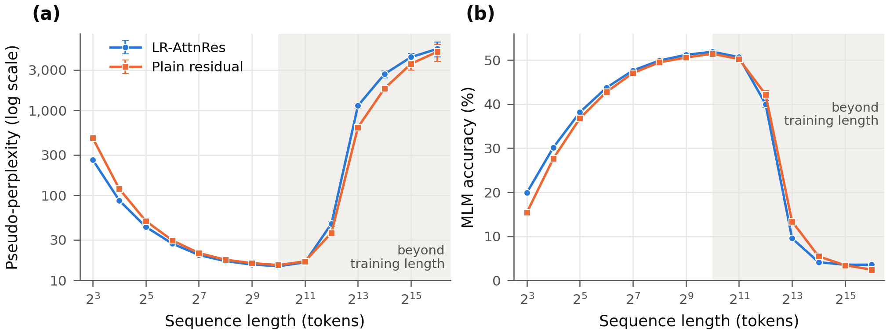
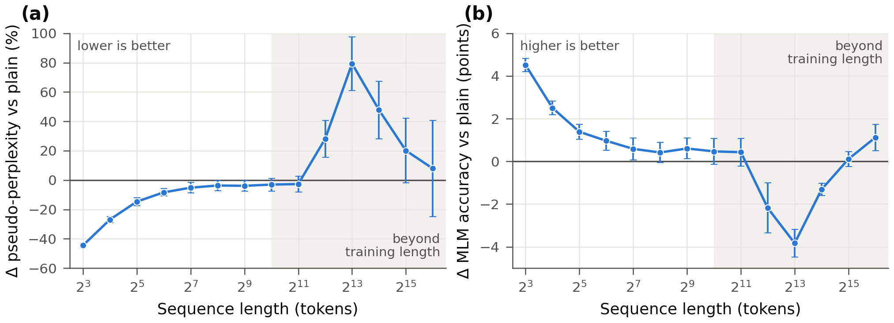

# LR-AttnRes-BERT

A BERT-style masked-language-model encoder built from deliberately plain layers —
**grouped-query attention + RoPE + a squared-ReLU MLP** — with **Block Sliced
Low-Rank Attention Residuals (LR-AttnRes)** in place of the residual sum. Two sizes
are defined: `base` (22 × 768, 151.8 M parameters, ModernBERT-base scale) and `tiny`
(8 × 384, 29.8 M).

This repository is **inference code** (PyTorch + 🤗 `transformers`): the model,
masked-LM and sequence-classification heads, `save_pretrained` / `from_pretrained`
support, a controlled ablation of LR-AttnRes, and speed / memory measurements. A
pretrained `tiny` checkpoint is on the Hugging Face Hub:
[`RikkaBotan/LR-AttnRes-BERT-tiny`](https://huggingface.co/RikkaBotan/LR-AttnRes-BERT-tiny).

**Summary of the results.**

* At the same parameter count (±1,024) and an identical 1 B-token recipe, LR-AttnRes
  gives **lower masked-LM pseudo-perplexity at every length up to the training length**.
  The gain is largest on short inputs: −44.5 % at 8 tokens, −14.7 % at 32 and
  −5.2 % at 128 (Table 3, Figure 2).
* Beyond twice the training length it **extrapolates worse** than the plain residual
  encoder: +28 % pseudo-perplexity at 4,096 tokens and +79 % at 8,192.
* Compiled with `torch.compile`, LR-AttnRes adds 0.7–18 % to the encoder's forward
  latency at the `base` size, depending on the input shape.

---

## Contents

1. [Pretrained checkpoint](#pretrained-checkpoint)
2. [Usage](#usage)
3. [Results: LR-AttnRes vs. the plain residual](#results-lr-attnres-vs-the-plain-residual)
4. [Architecture](#architecture)
5. [Speed and memory](#speed-and-memory)
6. [Install, tests, layout](#install)
7. [References](#references) · [Citation](#citation) · [License](#license)

## Pretrained checkpoint

| Model | Layers × hidden | Heads (query / KV) | LR-AttnRes | Params | Training | Context |
|:--|:--:|:--:|:--:|--:|:--|:--:|
| [`RikkaBotan/LR-AttnRes-BERT-tiny`](https://huggingface.co/RikkaBotan/LR-AttnRes-BERT-tiny) | 8 × 384 | 6 / 2 | rank 64, 8 groups, all reads | 29.8 M | MLM, 1 B tokens (Table 2) | 1,024 |

It is the *LR-AttnRes* arm of the ablation below: a research checkpoint trained on
1 B tokens at 1,024 tokens, with no long-context phase and no task fine-tuning. Use
it for masked-token prediction, as a backbone to fine-tune, or to study LR-AttnRes.
It has not been evaluated downstream, and it degrades sharply past 2,048 tokens
(Figure 1).

## Usage

The checkpoint ships its modeling code (`trust_remote_code=True`), so the first three
examples need only `transformers` (≥ 5.0) and `torch`. The tokenizer is ModernBERT's
(vocabulary 50,368, `[MASK]` = 50284) and is stored with the weights.

Every output below was produced by running the snippet as written. Two environments
were used: CPU, fp32, torch 2.12.0, transformers 5.10.2; and an RTX 5080 with
torch 2.12.1+cu132 and transformers 5.12.1. On the GPU, the bf16 and compiled runs
return the same top-5 tokens as the CPU fp32 run.

### Fill-mask with the `pipeline`

```python
from transformers import pipeline

fill = pipeline("fill-mask", model="RikkaBotan/LR-AttnRes-BERT-tiny", trust_remote_code=True)
for r in fill("Paris is the [MASK] of France.", top_k=5):
    print(f"{r['token_str'].strip():>8}  {r['score']:.3f}")
```

```text
 capital  0.050
    name  0.041
    part  0.025
    city  0.023
   heart  0.023
```

### Masked-LM logits, batched

```python
import torch
from transformers import AutoModelForMaskedLM, AutoTokenizer

model_id = "RikkaBotan/LR-AttnRes-BERT-tiny"
tok = AutoTokenizer.from_pretrained(model_id)
model = AutoModelForMaskedLM.from_pretrained(model_id, trust_remote_code=True).eval()

texts = ["The capital of France is [MASK].",
         "I like to drink [MASK] in the morning.",
         "def add(a, b):\n    return a [MASK] b"]
batch = tok(texts, padding=True, return_tensors="pt")
with torch.inference_mode():
    logits = model(**batch).logits                       # (3, T, 50368)

for i in range(len(texts)):
    pos = (batch["input_ids"][i] == tok.mask_token_id).nonzero()[0, 0]
    top = logits[i, pos].softmax(-1).topk(5)
    print([f"{tok.decode([t]).strip()} {p:.3f}" for p, t in zip(top.values.tolist(), top.indices.tolist())])
```

```text
['France 0.034', 'here 0.024', 'Italy 0.019', 'Germany 0.018', 'today 0.015']
['coffee 0.127', 'more 0.085', 'it 0.055', 'tea 0.054', 'water 0.046']
['+ 0.302', ', 0.253', 'as 0.094', '- 0.090', '* 0.066']
```

Pass `attention_mask` (the tokenizer does) whenever a batch is padded: padding never
reaches the real tokens. A 29.8 M model trained on 1 B tokens gets the type of the
missing word right more often than the fact, as in the first example.

### Sentence embeddings (masked mean pooling)

```python
import torch
import torch.nn.functional as F
from transformers import AutoModel, AutoTokenizer

model_id = "RikkaBotan/LR-AttnRes-BERT-tiny"
tok = AutoTokenizer.from_pretrained(model_id)
model = AutoModel.from_pretrained(model_id, trust_remote_code=True).eval()  # encoder only

sentences = ["A man is playing a guitar.",
             "Someone is playing an instrument.",
             "The stock market fell sharply today."]
batch = tok(sentences, padding=True, return_tensors="pt")
with torch.inference_mode():
    h = model(**batch).last_hidden_state                 # (3, T, 384)
m = batch["attention_mask"].unsqueeze(-1).to(h.dtype)
emb = F.normalize((h * m).sum(1) / m.sum(1), dim=-1)     # masked mean pooling
print(emb.shape)
print((emb @ emb.T).round(decimals=3))
```

```text
torch.Size([3, 384])
tensor([[1.0000, 0.9800, 0.9420],
        [0.9800, 1.0000, 0.9430],
        [0.9420, 0.9430, 1.0000]])
```

`AutoModel` loads the encoder, and its load report lists the three unused MLM-head
tensors (`head.dense.weight`, `head.norm.weight`, `decoder.bias`) as `UNEXPECTED`.
That is expected. These are raw masked-LM features: the paraphrase pair scores
highest, but every pair is above 0.94. Fine-tune the encoder (for example
contrastively) before using it for retrieval or similarity.

### With this package: bf16 on GPU + `torch.compile`

```python
import torch
from transformers import AutoTokenizer
from lr_attnres_bert import LRAttnResBertForMaskedLM     # pip install -e .

model_id = "RikkaBotan/LR-AttnRes-BERT-tiny"
tok = AutoTokenizer.from_pretrained(model_id)
model = LRAttnResBertForMaskedLM.from_pretrained(model_id, dtype=torch.bfloat16).cuda().eval()
model = torch.compile(model)

enc = tok("The capital of France is [MASK].", return_tensors="pt").to("cuda")
with torch.inference_mode():
    logits = model(**enc).logits                         # first call compiles
pos = (enc["input_ids"][0] == tok.mask_token_id).nonzero()[0, 0]
print([tok.decode([t]).strip() for t in logits[0, pos].topk(5).indices.tolist()])
```

```text
['France', 'here', 'Italy', 'Germany', 'today']
```

In this example, compiled bf16 and eager fp32 differ by at most 0.0018 in any token's
probability. Importing `lr_attnres_bert` registers the classes with `AutoConfig` and
the `AutoModel*` classes, so after the import `trust_remote_code` is not needed.

### Example scripts

| Script | What it does |
|:--|:--|
| [`examples/fill_mask.py`](examples/fill_mask.py) | top-k fill-mask; `--text`, `--top_k`, `--device`, `--dtype {fp32,bf16,fp16}` |
| [`examples/embeddings.py`](examples/embeddings.py) | masked-mean sentence embeddings and their cosine-similarity matrix |
| [`examples/quickstart.py`](examples/quickstart.py) | the local package: fill-mask, embeddings, a classification head on the encoder; `--compile`, `--random` |

```bash
python examples/fill_mask.py --text "Paris is the [MASK] of France." --top_k 10
```

All three scripts were run on CPU (fp32) and on CUDA (bf16; `quickstart.py` also with
`--compile`).

## Results: LR-AttnRes vs. the plain residual

### Setup

The two models are the `tiny` preset with and without LR-AttnRes and are otherwise
identical (Table 1). `attnres_rank = 0` is the plain pre-norm residual encoder: the
16 pseudo-queries are its only missing parameters. Both were trained with the same
recipe, data order and seed (Table 2), using a separate training pipeline that is not
part of this repository.

**Table 1.** The two models compared. Everything except the residual is shared.

| | LR-AttnRes | Plain residual |
|:--|:--:|:--:|
| layers × hidden, MLP | 8 × 384, ReLU² 1,152 | same |
| attention | 6 query / 2 KV heads (GQA), head dim 64, RoPE θ = 160,000 | same |
| residual | Block Sliced LR-AttnRes: rank 64, 8 groups, every read routed | sum |
| routing parameters | 16 queries × 64 = 1,024 | — |
| parameters (MLM / encoder) | 29,770,688 / 29,572,480 | 29,769,664 / 29,571,456 |

**Table 2.** Training recipe (phase 1 only), shared by both models.

| | |
|:--|:--|
| data | English web + code: [Ultra-FineWeb-L1](https://huggingface.co/datasets/openbmb/Ultra-FineWeb-L1) (six CC-MAIN-2025 snapshots) 55 %, [DCLM-Edu](https://huggingface.co/datasets/HuggingFaceTB/dclm-edu) 35 %, [UltraData-Code](https://huggingface.co/datasets/openbmb/UltraData-Code) (L3, 11 languages) 10 %, shares exact in tokens; ModernBERT tokenizer |
| examples | one document per example, ≤ 1,024 tokens, batches padded dynamically |
| tokens | 1 B content tokens; no long-context extension |
| objective | masked LM, constant 30 % masking (80 / 10 / 10) |
| batch | 512 sequences (global) |
| optimizer | AdamW, β = (0.9, 0.95), ε = 10⁻⁸, weight decay 0.1 (0 on the LR-AttnRes queries), gradient clip 1.0 |
| learning rate | peak 6 × 10⁻⁴; linear warmup over 6 % of the steps (at least 500); cosine decay to 10 % |
| precision | bf16 autocast, `torch.compile` |
| hardware / seed | 8 × RTX 5090 / 1234 |

**Evaluation protocol.**

* **Data.** Held-out text that neither model saw: a disjoint 0.1 % slice of the same
  55 / 35 / 10 mix, with documents packed back to back.
* **Windows.** For each length L ∈ {2³, …, 2¹⁶} there are 20 measurements of 65,536
  tokens each, so every measurement uses 65,536 / L full windows and no padding.
  Windows are spread evenly over the shard.
* **Masking.** 15 % of the non-special tokens are replaced by `[MASK]`, from a fixed
  seed. Both models are therefore scored on the same windows with the same positions
  masked.
* **Metrics.**
  * Pseudo-perplexity (PPPL): exp of the mean cross-entropy over the masked
    positions, the one-pass estimator of Salazar et al. (2020).
  * MLM accuracy: top-1 accuracy at the masked positions.
  * Each value is the mean ± 95 % Student-t confidence interval over the 20
    measurements. Inference runs in bf16 autocast.

### Pseudo-perplexity and MLM accuracy

**Table 3.** Masked-LM quality versus sequence length (mean ± 95 % CI over 20
measurements). Both models were trained at 1,024 tokens; † marks extrapolation. Bold
marks the better model where the two intervals do not overlap.

*(a) Pseudo-perplexity ↓*

| Model | 8 | 32 | 128 | 512 | 1,024 | 2,048† | 4,096† | 8,192† |
|:--|--:|--:|--:|--:|--:|--:|--:|--:|
| LR-AttnRes | **262.50 ± 4.02** | **42.66 ± 0.92** | 19.88 ± 0.53 | 15.34 ± 0.42 | 14.67 ± 0.46 | 16.27 ± 0.63 | 46.32 ± 3.40 | 1136.03 ± 77.73 |
| Plain residual | 473.08 ± 8.70 | 50.00 ± 1.15 | 20.97 ± 0.58 | 15.97 ± 0.42 | 15.13 ± 0.49 | 16.73 ± 0.65 | **36.16 ± 2.34** | **633.38 ± 47.92** |

*(b) MLM accuracy (%) ↑*

| Model | 8 | 32 | 128 | 512 | 1,024 | 2,048† | 4,096† | 8,192† |
|:--|--:|--:|--:|--:|--:|--:|--:|--:|
| LR-AttnRes | **19.91 ± 0.20** | **38.17 ± 0.25** | 47.66 ± 0.34 | 51.20 ± 0.37 | 51.91 ± 0.42 | 50.68 ± 0.44 | 40.03 ± 0.84 | 9.55 ± 0.34 |
| Plain residual | 15.40 ± 0.23 | 36.78 ± 0.24 | 47.07 ± 0.39 | 50.60 ± 0.31 | 51.44 ± 0.42 | 50.25 ± 0.47 | **42.22 ± 0.81** | **13.38 ± 0.55** |

<details><summary>All 14 lengths (8 – 65,536 tokens)</summary>

*Pseudo-perplexity ↓*

| Length | LR-AttnRes | Plain residual |
|--:|--:|--:|
| 8 | 262.497 ± 4.015 | 473.076 ± 8.697 |
| 16 | 87.282 ± 1.736 | 119.423 ± 2.458 |
| 32 | 42.662 ± 0.925 | 50.003 ± 1.155 |
| 64 | 27.082 ± 0.512 | 29.552 ± 0.597 |
| 128 | 19.880 ± 0.534 | 20.968 ± 0.582 |
| 256 | 16.842 ± 0.433 | 17.487 ± 0.438 |
| 512 | 15.342 ± 0.421 | 15.965 ± 0.425 |
| 1,024 | 14.666 ± 0.457 | 15.131 ± 0.487 |
| 2,048 | 16.275 ± 0.628 | 16.727 ± 0.647 |
| 4,096 | 46.322 ± 3.397 | 36.163 ± 2.336 |
| 8,192 | 1136.032 ± 77.727 | 633.382 ± 47.920 |
| 16,384 | 2677.180 ± 253.334 | 1811.299 ± 169.055 |
| 32,768 | 4242.503 ± 431.095 | 3532.056 ± 536.782 |
| 65,536 | 5311.087 ± 1070.909 | 4923.171 ± 1127.198 |

*MLM accuracy (%) ↑*

| Length | LR-AttnRes | Plain residual |
|--:|--:|--:|
| 8 | 19.91 ± 0.20 | 15.40 ± 0.23 |
| 16 | 30.17 ± 0.19 | 27.67 ± 0.25 |
| 32 | 38.17 ± 0.25 | 36.78 ± 0.24 |
| 64 | 43.74 ± 0.35 | 42.77 ± 0.27 |
| 128 | 47.66 ± 0.34 | 47.07 ± 0.39 |
| 256 | 49.92 ± 0.33 | 49.50 ± 0.33 |
| 512 | 51.20 ± 0.37 | 50.60 ± 0.31 |
| 1,024 | 51.91 ± 0.42 | 51.44 ± 0.42 |
| 2,048 | 50.68 ± 0.44 | 50.25 ± 0.47 |
| 4,096 | 40.03 ± 0.84 | 42.22 ± 0.81 |
| 8,192 | 9.55 ± 0.34 | 13.38 ± 0.55 |
| 16,384 | 4.13 ± 0.18 | 5.44 ± 0.22 |
| 32,768 | 3.55 ± 0.16 | 3.43 ± 0.31 |
| 65,536 | 3.55 ± 0.15 | 2.42 ± 0.60 |

</details>

<p align="center">
  
</p>

**Figure 1.** Masked-LM quality versus sequence length. (a) Pseudo-perplexity, log
scale (lower is better). (b) MLM accuracy (higher is better). Error bars are 95 %
CIs over 20 measurements; most are smaller than the markers. The shaded region is
beyond the training length (1,024). [PDF](docs/figures/fig1_quality_vs_length.pdf)

<p align="center">
  
</p>

**Figure 2.** LR-AttnRes minus the plain residual at each length. (a) Relative change
in pseudo-perplexity (%). (b) Change in MLM accuracy (points). The error bars are
95 % CIs of the difference. They treat the two models' intervals as independent,
which overstates them because the masks are shared. Below the zero line in (a) and
above it in (b), LR-AttnRes is better. [PDF](docs/figures/fig2_difference_vs_length.pdf)

### Findings

1. **Within the training length, LR-AttnRes is better, most of all on short inputs.**
   * Pseudo-perplexity falls by 44.5 ± 1.3 % at 8 tokens, 26.9 ± 2.1 % at 16,
     14.7 ± 2.7 % at 32, 8.4 ± 2.5 % at 64 and 5.2 ± 3.7 % at 128.
   * MLM accuracy rises by +4.5, +2.5, +1.4, +1.0 and +0.6 points at the same lengths.
   * From 256 to 2,048 tokens LR-AttnRes stays ahead (−2.7 to −3.9 % PPPL, +0.4 to
     +0.6 points). The intervals of the difference include zero at 1,024 and 2,048,
     and also at 256 for accuracy.
   * Short windows give attention the least context. That is where a learned
     depth-wise mix of earlier layers has the most to add.
2. **Beyond twice the training length, LR-AttnRes extrapolates worse.**
   * Pseudo-perplexity is 28.1 ± 12.5 % higher at 4,096 tokens, 79.4 ± 18.3 % at
     8,192 and 47.8 ± 19.6 % at 16,384.
   * MLM accuracy is 2.2, 3.8 and 1.3 points lower at the same lengths.
   * By 32,768 tokens both models have collapsed to 2–4 % accuracy, so the
     differences there do not say which model is more useful.
   * We have not isolated the cause. One untested hypothesis: the routing keys are
     normalised tails of the residual sources, whose statistics shift when attention
     meets unseen RoPE positions, and the learned mix then amplifies the shift.
     Training on longer sequences, which neither model received, is the obvious
     remedy to test.
3. **The cost is small.** LR-AttnRes adds 1,024 parameters at `tiny` and 5,632 at
   `base`. Compiled, it adds 0.7–18 % to the encoder's forward latency at `base`,
   depending on the input shape ([Speed and memory](#speed-and-memory)).

### Limitations

* **One training run per model.** The CIs cover evaluation sampling (which text is
  scored), not run-to-run training variance. Differences of about half a point,
  such as those at 128–2,048 tokens, need more seeds before they can be relied on.
* **One scale and one training phase.** The study covers 29.8 M parameters, 1 B
  tokens and 1,024 tokens of context. The `base` preset has not been trained, and
  nothing here measures downstream (GLUE, retrieval) quality.
* **The long end measures concatenated documents.** The evaluation shard packs
  documents back to back, so windows longer than a document span several documents.
  Both models see identical windows, so the comparison is fair, but the absolute
  long-length numbers are not those of single long documents.
* **The CIs of the difference are approximate.** Per-measurement values were not
  stored, so the paired test the shared masks would allow could not be run. The
  independent-sample intervals in Figure 2 are conservative.

The raw scores are in [`results/tiny_ablation/`](results/tiny_ablation). To redraw
the figures and print the tables (requires matplotlib):

```bash
python results/make_figures.py --tables
```

## Architecture

| | LR-AttnRes-BERT (`base`) | ModernBERT-base (reference) |
|---|---|---|
| layers / hidden | 22 / 768 | 22 / 768 |
| attention | 12 query heads, **4 KV heads (GQA)**, head dim 64, full (global) attention in every layer | 12 heads (MHA); global every 3rd layer, 128-token sliding window otherwise |
| positions | RoPE, θ = 160 000 | RoPE, θ = 160 000 (global) / 10 000 (local) |
| MLP | **ReLU²**: `W_o relu(W_i x)²`, 768 → 2304 → 768 | GeGLU, 768 → 2 × 1152 → 768 |
| norm | RMSNorm, pre-norm | LayerNorm (no bias), pre-norm |
| residual | **Block Sliced LR-AttnRes** | sum |
| bias terms | none in the encoder | none in the encoder |
| vocabulary / tokenizer | 50 368, ModernBERT's tokenizer and special-token ids | same |
| max length | 8192 | 8192 |
| parameters (MLM / encoder) | 151.8 M / 151.2 M | 149.6 M / 149.0 M |

The MLP width (2304 = 3 × 768) is chosen so that the non-gated ReLU² MLP plus the
cheaper GQA attention land at ModernBERT-base's parameter count (+1.5%).

### LR-AttnRes

In a standard pre-norm encoder every sublayer reads the residual sum
`x = emb + Σ writes`. Attention Residuals replace a read with a softmax mix over depth
of the earlier residual writes. The **sliced low-rank** variant (Su, 2026) routes on
only the last `r` channels of each source:

```
alpha_i = softmax_i( q_t · RMSNorm(tail_r(s_i)) )      q_t ∈ R^r, learned, one per read
h_t     = Σ_i alpha_i s_i                              (full-width values)
```

* **Sources (Block AttnRes).** The 44 sublayer writes (22 attention + 22 MLP) are
  summed into `attnres_blocks = 8` groups, which close after writes 6, 11, 17, 22, 28,
  33, 39 and 44. The sources of a read are the embedding, the closed groups and the
  open group's partial sum: at most nine.
* **Routed reads** (`attnres_read_sites = "all"`, as in the paper). Every attention
  input, every MLP input and the encoder output read the mix. The first attention
  input sees only the embedding and has no query, so there are 44 queries of rank
  `r = 128`: **5 632 parameters** in all. The `"attention"` setting routes only the
  attention inputs and the output, and the MLPs read the plain residual sum. It is
  cheaper, but it is not the paper's setup.
* **Initialisation.** The queries start at zero, so every routed read starts as the
  residual sum divided by the number of sources. The RMSNorm that follows removes
  that factor. A fresh LR-AttnRes-BERT therefore computes what the plain encoder with
  the same weights computes, and `attnres_rank = 0` *is* that plain encoder (no
  queries).
* **Evaluation.** Between two group closes, the closed sources and the queries are
  fixed. At each close, one batched matmul mixes the closed sources for every read of
  the coming segment and keeps their log-sum-exp. Each read then merges in the open
  partial sum with one online-softmax step,
  `h = lerp(hc, partial, sigmoid(q · key(partial) − lse))`. The result is exactly the
  softmax above, but the closed sources are touched once per segment instead of once
  per read.

### Presets

| preset | layers × hidden | heads (query / KV) | MLP | LR-AttnRes rank | params |
|---|---|---|---|---|---:|
| `base` (default) | 22 × 768 | 12 / 4 | 2304 | 128 | 151.8 M |
| `tiny` | 8 × 384 | 6 / 2 | 1152 | 64 | 29.8 M |

`tiny` keeps the base ratios: MLP 3×, GQA 3:1, head dim 64, rank = hidden / 6. Build
it with `LRAttnResBertConfig.from_preset("tiny")`; the pretrained checkpoint uses this
preset. The modules are plain PyTorch, so any MLM training loop can train them. Mixed
precision is supported: under autocast the residual sources stay in fp32 and the
routing runs outside autocast.

* `LRAttnResBertModel` is the encoder (`last_hidden_state`). With
  `output_hidden_states` it also returns the embedding and the plain residual sum
  after each layer.
* `LRAttnResBertForMaskedLM` has a tied decoder.
* `LRAttnResBertForSequenceClassification` uses masked-mean or first-token pooling,
  then a prediction head and a linear classifier.
* `save_pretrained` writes an `auto_map` and copies the modeling code next to the
  weights. A saved directory therefore loads without this package via
  `AutoModel*.from_pretrained(path, trust_remote_code=True)`.

## Speed and memory

Measured with `benchmarks/benchmark_inference.py` on one **RTX 5080 (16 GB)** at the
`base` size:

* bf16 weights under `torch.inference_mode`;
* the **encoder forward pass** only (`last_hidden_state`, no vocabulary projection);
* full-length inputs (no padding);
* the median of 20 forwards after 5 warm-up forwards.

Three models are compared:

* **LR-AttnRes-BERT**, the `base` configuration. The weights are random: speed and
  memory do not depend on their values. The queries are non-zero, so the routed path
  is the one timed.
* **same, LR-AttnRes off**, the identical configuration with `attnres_rank=0`, i.e.
  the plain residual encoder. The difference between the first two is exactly what
  LR-AttnRes costs.
* **ModernBERT-base**, `answerdotai/ModernBERT-base` through `transformers` with SDPA
  attention, the reference at the same depth and width. flash-attn is not installed
  here, so its sliding-window layers run as masked SDPA. With flash-attn (unpadded,
  windowed kernels) ModernBERT is faster than shown, especially at long lengths.

_NVIDIA GeForce RTX 5080, torch 2.12.1+cu132 (CUDA 13.2), transformers 5.12.1, bf16, median of 20 forwards after 5 warm-up._

**Table 4.** Latency (ms) and throughput (k tokens/s), eager.

| batch x length | LR-AttnRes-BERT | same, LR-AttnRes off | ModernBERT-base | LR-AttnRes overhead |
|---|---:|---:|---:|---:|
| 1 x 512 | 17.03 (30k) | 8.86 (58k) | 9.83 (52k) | +92.2% |
| 64 x 128 | 41.65 (197k) | 29.78 (275k) | 44.77 (183k) | +39.9% |
| 32 x 512 | 91.81 (178k) | 70.33 (233k) | 96.06 (171k) | +30.5% |
| 8 x 2048 | 123.20 (133k) | 100.85 (162k) | 129.46 (127k) | +22.2% |
| 2 x 8192 | 251.53 (65k) | 229.77 (71k) | 273.95 (60k) | +9.5% |

**Table 5.** Latency (ms) and throughput (k tokens/s), `torch.compile`.

| batch x length | LR-AttnRes-BERT | same, LR-AttnRes off | ModernBERT-base | LR-AttnRes overhead |
|---|---:|---:|---:|---:|
| 1 x 512 | 4.64 (110k) | 4.18 (122k) | 4.67 (110k) | +10.9% |
| 64 x 128 | 31.16 (263k) | 30.95 (265k) | 32.68 (251k) | +0.7% |
| 32 x 512 | 72.11 (227k) | 60.89 (269k) | 76.53 (214k) | +18.4% |
| 8 x 2048 | 103.89 (158k) | 91.65 (179k) | 166.22 (99k) | +13.4% |
| 2 x 8192 | 232.49 (70k) | 220.56 (74k) | 562.36 (29k) | +5.4% |

**Table 6.** Peak memory (GiB, weights included), eager.

| batch x length | LR-AttnRes-BERT | same, LR-AttnRes off | ModernBERT-base |
|---|---:|---:|---:|
| weights only | 0.287 | 0.287 | 0.287 |
| 1 x 512 | 0.340 | 0.294 | 0.299 |
| 64 x 128 | 0.664 | 0.389 | 0.463 |
| 32 x 512 | 1.010 | 0.491 | 0.639 |
| 8 x 2048 | 1.011 | 0.491 | 0.644 |
| 2 x 8192 | 1.013 | 0.493 | 1.311 |

**Table 7.** Peak memory (GiB, weights included), `torch.compile`.

| batch x length | LR-AttnRes-BERT | same, LR-AttnRes off | ModernBERT-base |
|---|---:|---:|---:|
| weights only | 0.287 | 0.287 | 0.287 |
| 1 x 512 | 0.342 | 0.294 | 0.310 |
| 64 x 128 | 1.143 | 0.401 | 0.442 |
| 32 x 512 | 2.000 | 0.502 | 0.889 |
| 8 x 2048 | 2.000 | 0.502 | 2.061 |
| 2 x 8192 | 2.000 | 0.502 | 6.748 |

How to read it:

* **Use `torch.compile`.** Every routed read adds a handful of small kernels, and
  there are 44 reads. In eager mode LR-AttnRes costs +10% at 2 × 8192 but roughly
  doubles the latency of a single 512-token sequence, where kernel launches
  dominate. Compiled, the overhead is +5% at 2 × 8192, +13–18% at 512–2048 tokens
  per sequence, and within noise at 64 × 128.
* **Memory grows with the token count, not the length.** For every token, a forward
  keeps up to nine residual sources (the embedding and the closed groups) alive, plus
  the mixed reads of the current segment. The peak is therefore the same for
  32 × 512, 8 × 2048 and 2 × 8192 (16 384 tokens each). The attention itself stays
  O(T) on SDPA's flash path. ModernBERT's masked sliding-window SDPA grows with the
  length instead.
* The compiled 1 × 512 cells are overhead-bound and vary by about 1 ms between runs.
  The plain model's cell is the mean of two 100-iteration runs (3.62 and 4.75 ms).

Reproduce:

```bash
python benchmarks/benchmark_inference.py            # -> benchmarks/results/cuda.json
python benchmarks/make_tables.py benchmarks/results/cuda.json
```

`--models`, `--modes`, `--shapes`, `--dtype` and `--device cpu` select a subset.

## Install

```bash
pip install -e .            # torch >= 2.4, transformers >= 5.0
```

The Hub checkpoint carries its tokenizer. For an untrained model, use ModernBERT's:
`AutoTokenizer.from_pretrained("answerdotai/ModernBERT-base")`.

## Tests

```bash
pip install -e ".[test]"
python -m pytest -q tests
```

The tests run on CPU with a tiny configuration and cover:

* the ModernBERT-base-scale defaults (≈150 M parameters, tied decoder, group
  boundaries) and the `tiny` preset;
* the read sites, and a routed read checked against a direct computation;
* zero-query reads matching the plain encoder;
* padding never reaching real tokens;
* gradients reaching every parameter;
* bf16 inference, and the stream staying fp32 under autocast;
* the `save_pretrained` → `from_pretrained` / `AutoModel*` round trip being exact.

## Layout

```
src/lr_attnres_bert/
  configuration_lr_attnres_bert.py   LRAttnResBertConfig (+ presets)
  modeling_lr_attnres_bert.py        the encoder, LR-AttnRes stream, heads
examples/fill_mask.py                fill-mask from the Hub (trust_remote_code)
examples/embeddings.py               masked-mean sentence embeddings
examples/quickstart.py               the local package: fill-mask, embeddings, classifier
results/tiny_ablation/               raw ablation scores (JSON)
results/make_figures.py              scores -> docs/figures/*, Table 3
docs/figures/                        Figures 1-2 (PNG, 300 dpi, and PDF)
docs/hf_model_card.md                the Hugging Face model card of the tiny checkpoint
benchmarks/benchmark_inference.py    speed / memory measurement -> results/*.json
benchmarks/make_tables.py            results JSON -> Tables 4-7
benchmarks/results/                  raw measurements
tests/test_modeling.py               CPU tests
```

## References

* J. Su. *Low-Rank Attention Residuals.* arXiv:2607.09694, 2026 — sliced low-rank
  routing keys and Block AttnRes.
* B. Warner et al. *Smarter, Better, Faster, Longer: A Modern Bidirectional Encoder
  for Fast, Memory Efficient, and Long Context Finetuning and Inference* (ModernBERT).
  arXiv:2412.13663, 2024.
* J. Salazar, D. Liang, T. Q. Nguyen, K. Kirchhoff. *Masked Language Model Scoring.*
  ACL 2020 — pseudo-perplexity.
* J. Ainslie et al. *GQA: Training Generalized Multi-Query Transformer Models from
  Multi-Head Checkpoints.* arXiv:2305.13245, 2023.
* J. Su et al. *RoFormer: Enhanced Transformer with Rotary Position Embedding.*
  arXiv:2104.09864, 2021.
* D. So et al. *Primer: Searching for Efficient Transformers for Language Modeling*
  (squared ReLU). arXiv:2109.08668, 2021.

## Citation

```bibtex
@misc{lr-attnres-bert,
  title        = {{LR-AttnRes-BERT}: A {BERT}-style encoder with Block Sliced Low-Rank Attention Residuals},
  author       = {Rikka Botan},
  year         = {2026},
  howpublished = {\url{https://github.com/Rikka-Botan/LR-AttnRes-BERT}}
}
```

## License

MIT — see [LICENSE](LICENSE).
